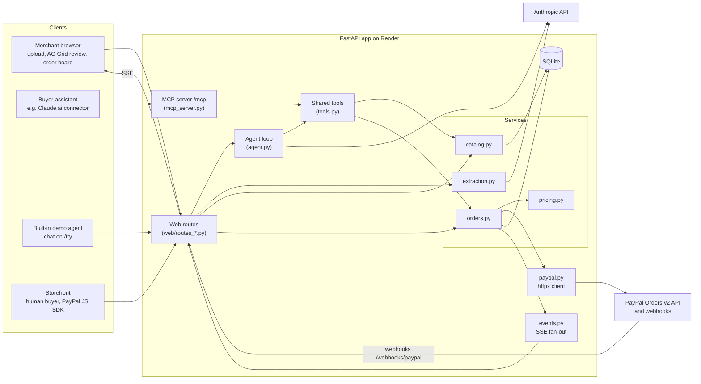

# Architecture

Awning is one FastAPI app (Python 3.12). Every channel, whether the storefront, the built-in demo agent or an external assistant over MCP, goes through the same service layer, so pricing and order logic live in one place.

## Walk-through of an agent order

1. The buyer asks their assistant for "2 oat lattes from Maria's Cart for 9am". The assistant calls `find_shops` and `get_menu` over MCP ([mcp_server.py](../src/awning/mcp_server.py)). Menu text comes back marked as merchant data.
2. The assistant calls `create_order` with item IDs, option IDs and quantities only ([tools.py](../src/awning/tools.py)).
3. `OrderService.place_order` ([orders.py](../src/awning/orders.py)) prices the lines from the stored catalog with [pricing.py](../src/awning/pricing.py), rejecting unknown IDs and absurd quantities.
4. The PayPal client ([paypal.py](../src/awning/paypal.py)) creates an Orders v2 order with `intent: CAPTURE`, itemized amounts, `payee` set to the shop's merchant ID or email, and `experience_context` return and cancel URLs. The order is stored as `awaiting_payment`.
5. The tool returns a summary and the PayPal `payer-action` approval URL. Nothing is charged yet.
6. The buyer approves in PayPal and is redirected to `/o/{order_id}/return` ([routes_shop.py](../src/awning/web/routes_shop.py)). The server captures with an idempotency key (`PayPal-Request-Id`) and marks the order `paid` only if PayPal reports `COMPLETED`.
7. The status change is published to the in-process event bus ([events.py](../src/awning/events.py)) and the merchant's board updates over SSE ([routes_board.py](../src/awning/web/routes_board.py)).
8. Backup path: PayPal webhooks reach `/webhooks/paypal` ([routes_webhooks.py](../src/awning/web/routes_webhooks.py)), are verified through PayPal's verify-webhook-signature API, and run the same idempotent completion. The order page also polls PayPal. In sandbox, webhooks for third-party payees arrived about 2 minutes late, so the return-URL capture is primary.

The merchant onboarding path is separate: photo, then [images.py](../src/awning/images.py) downscale, then [extraction.py](../src/awning/extraction.py) (Claude vision, structured output), then the AG Grid review page, then publish in [catalog.py](../src/awning/catalog.py).
